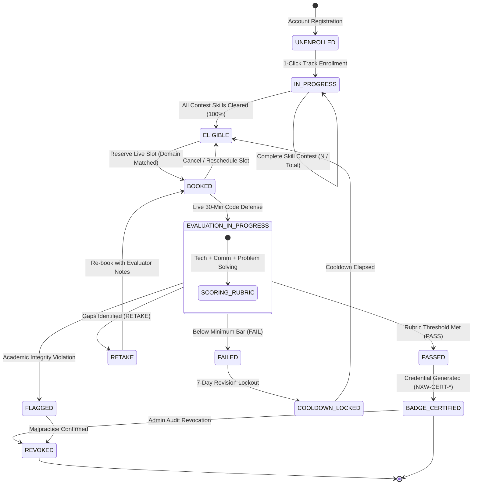
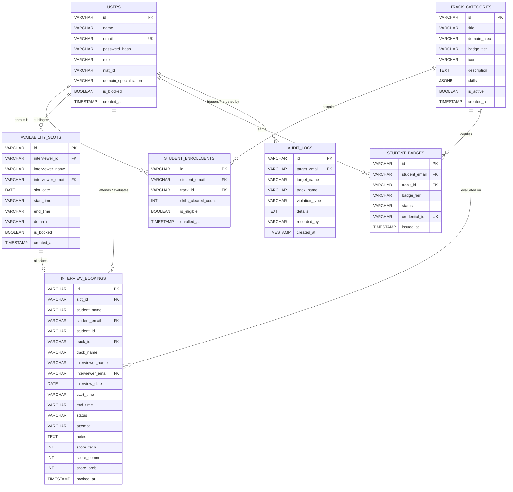

# NextWave Technical Clearance: Student Interview Journey & System Specification

This document provides a concise, production-ready specification of the NextWave Skilling and Interview Clearance platform. It details the complete state lifecycle of a candidate, the edge cases and engineering assumptions we enforce, and the relational PostgreSQL schema backing the system.

---

## 1. Student Clearance Lifecycle & State Machine

Every candidate progresses through a deterministic lifecycle. No student can skip prerequisite skills, bypass live evaluation, or claim credentials without faculty sign-off.

### 1.1 State Transition Diagram



---

### 1.2 State Transition Matrix

| Current State | Next State | Trigger / Action | System Enforcements & Side Effects |
| :--- | :--- | :--- | :--- |
| **`UNENROLLED`** | **`IN_PROGRESS`** | Student browses tracks and clicks *Enroll Track*. | Creates row in `student_enrollments` (`skills_cleared_count = 0`, `is_eligible = false`). Track enrolled counter increments. |
| **`IN_PROGRESS`** | **`IN_PROGRESS`** | Student clears individual skill contest level. | Increments `skills_cleared_count`. Progress bar updates dynamically. Live defense booking button remains locked. |
| **`IN_PROGRESS`** | **`ELIGIBLE`** | Student clears final prerequisite skill ($N = Total$). | Sets `is_eligible = true`. Creates initial `interview_bookings` entry with status `Not Booked`. Unlocks the 3-step *Book Live Defense* gateway. |
| **`ELIGIBLE`** | **`BOOKED`** | Student selects date, time, and faculty member. | Atomically flags `availability_slots.is_booked = true` and links slot to candidate. Filters out non-matching domain evaluators. |
| **`BOOKED`** | **`ELIGIBLE`** | Student or admin cancels the booking. | Reverts `availability_slots.is_booked = false` back into the public pool. Resets booking record to `Not Booked`. |
| **`BOOKED`** | **`EVALUATION`** | Evaluator opens candidate from the evaluation queue. | Loads candidate context, past attempts, and the 3-axis rubric (Technical Depth, Communication, Problem Solving). |
| **`EVALUATION`** | **`PASSED`** | Evaluator submits decision = `PASS`. | Evaluator notes saved to booking. Inserts row into `student_badges` with status `ACTIVE` and unique verification hash `NXW-CERT-2026-XXXX`. Candidate removed from pending queue. |
| **`EVALUATION`** | **`RETAKE`** | Evaluator submits decision = `RETAKE`. | Specific improvement notes attached to student's portal. Candidate allowed to re-book without resetting skill progression. |
| **`EVALUATION`** | **`FAILED`** | Evaluator submits decision = `FAIL`. | Initiates a 7-day cooldown revision lockout. Candidate cannot re-book until review period passes. |
| **`EVALUATION`** | **`FLAGGED`** | Evaluator flags unauthorized aids / plagiarism. | Moves booking to `Flagged`. Logs high-severity security record in `audit_logs` for Dean/Admin review. |
| **`PASSED`** | **`REVOKED`** | Admin confirms audit discrepancy or malpractice. | Updates `student_badges.status = 'REVOKED'`. Appends tamper-evident badge strike into integrity audit log. |

---

## 2. Edge Cases Handled & Operating Assumptions

Building a robust scheduling platform requires handling concurrency, human error, and administrative actions cleanly.

### 2.1 Critical Edge Cases & How We Handle Them

1. **Concurrent Booking Race Condition (Double-Booking a Single Slot)**:
   - *Problem*: Two students click the same `10:00 AM` slot at the exact same millisecond.
   - *Handling*: PostgreSQL handles this with atomic conditional updates: `UPDATE availability_slots SET is_booked = true WHERE id = $1 AND is_booked = false RETURNING id`. If rows updated is zero, the second request receives a `409 Conflict` and is prompted to choose another window.
2. **Interviewer Duplicate Slot Publishing**:
   - *Problem*: Evaluators accidentally clicking *Publish* repeatedly or publishing overlapping times on the same date.
   - *Handling*: 
     - **Database level**: `POST /api/slots` queries for existing records on `(interviewer_email, slot_date, start_time)` and rejects duplicates with `409 Conflict`.
     - **UI level**: As soon as a date is chosen, the time dropdown dynamically cross-references the schedule and disables already-published windows with a `🔒 (Already Published)` tag. The submit button disables during network calls.
3. **Faculty Account Deletion or Administrative Blocking**:
   - *Problem*: An interviewer leaves the institute or is suspended while having open and reserved slots.
   - *Handling*: When an admin blocks or removes an evaluator, unbooked slots are immediately deleted from the scheduling pool. Already-booked candidates are retained with an `Unassigned / Needs Reassignment` flag and alerted to reschedule.
4. **Domain Specialization Mismatch**:
   - *Problem*: A candidate defending *Data Analytics* booking a *Full Stack* evaluator who cannot properly grade SQL or statistical pipelines.
   - *Handling*: Strict domain-based routing. The student booking gateway matches `track.domain_area` against `users.domain_specialization`. Only faculty certified in that specific track domain are presented to the candidate.
5. **Cooldown Revision Lockout on Failure**:
   - *Problem*: A candidate failing a defense immediately booking the next available slot 20 minutes later without revising.
   - *Handling*: Failed attempts log `last_failed_at = NOW()`. The booking gateway enforces a 7-day cooldown window before the scheduling calendar unlocks for that track.
6. **Student Rescheduling / No-Show Handling**:
   - *Problem*: Student unable to attend an interview or abandoning a slot.
   - *Handling*: Cancellations require at least 2 hours advance notice. Cancelling safely releases the `availability_slots` record back to the open pool for other students to claim.
7. **Tamper-Evident Credential Verification**:
   - *Problem*: A student inspecting DOM elements to fabricate a passing certificate.
   - *Handling*: Every digital certificate generates a deterministic credential ID (`NXW-CERT-2026-XXXX`). The public ledger endpoint independently checks `student_badges` in PostgreSQL before rendering verification seals.

### 2.2 Core Assumptions Made

- **Slot Granularity**: All defense sessions are scheduled for 30-minute interactive windows with 15 minutes of evaluator grading buffer (45 minutes total allocation).
- **Single Active Defense per Track**: A student can only have **one active scheduled booking** per enrolled track at any given time.
- **Track Scope**: Prerequisite skill contest counts are deterministic (typically 5 to 6 core competencies per track) and must reach 100% completion before clearance scheduling unlocks.
- **Role Hierarchy**: 
  - `student`: Can browse, enroll, clear skills, and book defenses.
  - `interviewer`: Can publish availability, evaluate assigned candidates, score rubrics, and record Pass/Fail/Retake.
  - `admin`: Global supervisory authority over tracks, faculty assignments, accounts, pipeline status, and audit logs.

---

## 3. Production PostgreSQL Data Model

The schema uses relational integrity with foreign key relationships, audit timestamps, and indexing on high-frequency query paths.

### 3.1 Entity Relationship Diagram



---

### 3.2 Schema Details & Table DDL

#### 1. `users` (Identity & Role-Based Access)
Stores candidates, domain faculty, and administrators.
- `id` (VARCHAR, PK): Unique user identifier (`usr-XXXX`).
- `name` (VARCHAR, NOT NULL): Full human name.
- `email` (VARCHAR, UNIQUE, NOT NULL): Normalized lowercase email address.
- `password_hash` (VARCHAR, NOT NULL): Credential token or password hash.
- `role` (VARCHAR, NOT NULL): One of `'student'`, `'interviewer'`, or `'admin'`.
- `niat_id` (VARCHAR): Institutional student identifier (e.g. `NIAT2024-4104`).
- `domain_specialization` (VARCHAR): Comma-separated domains for faculty (e.g. `Full Stack Development, AI Product Mastery`).
- `is_blocked` (BOOLEAN, DEFAULT FALSE): Administrative suspension flag.

#### 2. `track_categories` (Curriculum & Credential Gateways)
Defines technical competencies, prerequisites, and badge classifications.
- `id` (VARCHAR, PK): Canonical track identifier (`track-fs`, `track-da`).
- `title` (VARCHAR, NOT NULL): Full title (e.g. `Full Stack Development`).
- `domain_area` (VARCHAR, NOT NULL): Matching domain key for interviewer allocation.
- `badge_tier` (VARCHAR, DEFAULT 'Novice'): Level of badge (`Novice`, `Advanced`, `Master`).
- `skills` (JSONB / TEXT[], NOT NULL): Ordered array of required skill contest names.
- `is_active` (BOOLEAN, DEFAULT TRUE): Toggle to disable/archive obsolete tracks.

#### 3. `student_enrollments` (Skill Contest Progression)
Tracks how many contest levels a candidate has completed before live interview unlock.
- `id` (VARCHAR, PK): Unique enrollment record ID.
- `student_email` (VARCHAR, NOT NULL, REFERENCES users(email)): Candidate identity.
- `track_id` (VARCHAR, NOT NULL, REFERENCES track_categories(id)): Associated track.
- `skills_cleared_count` (INT, DEFAULT 0): Completed prerequisite skill count.
- `is_eligible` (BOOLEAN, DEFAULT FALSE): Unlocks the *Book Live Defense* gateway when `skills_cleared_count >= total_skills`.

#### 4. `availability_slots` (Faculty Publishing Calendar)
Open and booked 30-minute interview windows published by faculty.
- `id` (VARCHAR, PK): Unique slot identifier (`slot-XXXX`).
- `interviewer_email` (VARCHAR, NOT NULL, REFERENCES users(email)): Publishing faculty.
- `slot_date` (DATE, NOT NULL): Normalized interview calendar day (`YYYY-MM-DD`).
- `start_time` (VARCHAR, NOT NULL): Normalized start window (e.g. `10:00 AM`).
- `end_time` (VARCHAR, NOT NULL): Normalized end window (e.g. `10:45 AM`).
- `domain` (VARCHAR, NOT NULL): Track domain allocated to this window.
- `is_booked` (BOOLEAN, DEFAULT FALSE): Concurrency lock flag.
- **Unique Constraint**: `UNIQUE(interviewer_email, slot_date, start_time)` prevents duplicate publication.

#### 5. `interview_bookings` (The Active Pipeline & Grading Ledger)
Tracks every scheduled defense, evaluator scoring, and clearance outcome.
- `id` (VARCHAR, PK): Booking reference (`book-XXXX`).
- `slot_id` (VARCHAR, REFERENCES availability_slots(id)): Linked availability slot.
- `student_email` (VARCHAR, NOT NULL): Candidate taking the defense.
- `interviewer_email` (VARCHAR, NOT NULL): Faculty conducting the evaluation.
- `status` (VARCHAR, NOT NULL): Current state (`'Not Booked'`, `'Booked'`, `'Passed'`, `'Failed'`, `'Retake'`, `'Flagged'`).
- `attempt` (VARCHAR, DEFAULT '1st'): Attempt counter (`'1st'`, `'2nd'`, `'3rd'`).
- `notes` (TEXT): Comprehensive faculty feedback shown on digital credentials.
- `score_tech`, `score_comm`, `score_prob` (INT 1–5): 3-axis rubric competency ratings.

#### 6. `student_badges` (Certified Credentials & Verification Vault)
Permanent digital badge registry for candidates who have passed live faculty defense.
- `id` (VARCHAR, PK): Unique badge badge ID (`bdg-XXXX`).
- `student_email` (VARCHAR, NOT NULL): Badge owner.
- `track_id` (VARCHAR, NOT NULL): Certified engineering track.
- `credential_id` (VARCHAR, UNIQUE, NOT NULL): Tamper-evident verify code (`NXW-CERT-2026-LIVE`).
- `status` (VARCHAR, DEFAULT 'ACTIVE'): Status (`'ACTIVE'` or `'REVOKED'`).
- `issued_at` (TIMESTAMP, DEFAULT NOW()): Official certification timestamp.

#### 7. `audit_logs` (Academic Integrity & Malpractice Auditing)
Append-only ledger of security violations, malpractice investigations, and manual badge revocations.
- `id` (VARCHAR, PK): Audit event ID.
- `target_email` (VARCHAR, NOT NULL): Student or faculty under review.
- `violation_type` (VARCHAR, NOT NULL): Violation label (`'Unauthorized Collaboration'`, `'Identity Mismatch'`).
- `details` (TEXT, NOT NULL): Comprehensive incident summary and evidence.
- `recorded_by` (VARCHAR, NOT NULL): Administrator or faculty reporting the infraction.
- `created_at` (TIMESTAMP, DEFAULT NOW()): Incident timestamp.

---

### 3.3 Key Indexes for High-Traffic Query Paths

```sql
-- Fast candidate dashboard lookups
CREATE INDEX idx_enrollments_student ON student_enrollments(LOWER(student_email));
CREATE INDEX idx_bookings_student ON interview_bookings(LOWER(student_email));

-- Fast domain and interviewer availability matching
CREATE INDEX idx_slots_lookup ON availability_slots(LOWER(interviewer_email), slot_date, is_booked);
CREATE INDEX idx_slots_domain ON availability_slots(domain, is_booked);

-- Immediate public certificate verification
CREATE INDEX idx_badges_credential ON student_badges(credential_id);
```

---

## 4. Summary of Design Strengths

1. **Deterministic Progression**: Zero ambiguity on how a student reaches certification.
2. **Double-Booking & Duplicate Immunity**: Guaranteed at both database constraint and interactive UI layers.
3. **Domain Integrity**: Interviewers only evaluate domains they are qualified to assess.
4. **Permanent Audit Trail**: Decisions, rubric ratings, feedback notes, and revocations remain queryable for institutional accreditation.
